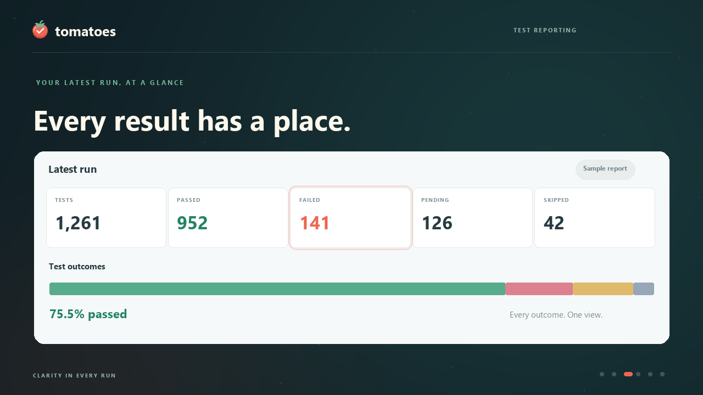

# Tomatoes

**A test report dashboard for Cypress-generated cloud test results.**

Tomatoes turns JSON reports from Cypress test runs into a dashboard for reviewing outcomes, investigating failures, and comparing previous runs. Reports can come from tests executed in a cloud CI environment or on a local machine.

Tomatoes is an independent application with its own branding. It is not the Cypress Cloud product. Cypress is the tool that executes the tests; Tomatoes reads the resulting **Mochawesome-compatible JSON report** and presents the results.

The application runs locally. Imports and evidence are available in your browser; **Settings > Sharing & access** uses PostgreSQL or the local file store for persistent server copies. With PostgreSQL enabled, new file imports and attachments are also saved to the server when your account has access. It does not require a Cypress Cloud account, recording key, or API connection.

## See Tomatoes in action

[](docs/media/tomatoes-promo.mp4)

[Watch or download the 28-second animated promo](docs/media/tomatoes-promo.mp4), featuring the dashboard, insights, and responsive layouts with an original soundtrack.

**Created by Alex Ali.**

## Get started

With Node.js and npm installed, run:

```sh
npm install
npm start
```

Open [Tomatoes](http://localhost:3000/#runs).

The project includes a sample run in `examples/reports/results.json`, originally supplied as `index.json`. You can explore it immediately or choose **Import report** to open your own JSON file.

## Bring in a Cypress report

1. Execute your Cypress tests locally or through your cloud CI pipeline.
2. Generate a Mochawesome-compatible JSON report from the run. For a run with several report files, use a merged report to review the complete run together.
3. Download the report artifact from your pipeline, if applicable.
4. Select **Import report** in Tomatoes, then drag a `.json` file into the drop area or use **Browse files**. Import one report at a time, up to 50 MB.
5. Review the dashboard, browse tests, or open Analytics to investigate the run.

Tomatoes imports exported reports. Running tests and collecting artifacts remain part of your Cypress setup and CI workflow.

### Supported format and validation

Reports must contain a Mochawesome `stats` object and a `results` array with spec files, nested suites, and test records. A `.json` extension alone is insufficient.

Before displaying a report, Tomatoes checks JSON syntax, required statistics, suite and test structure, outcome values, field types, dates, and durations. Invalid imports show a specific error and preserve the displayed report.

Import limits:

- Maximum file size: **50 MB**.
- Maximum combined suite and test records: **100,000**.
- Maximum suite nesting depth: **100**.

A blocking loading overlay shows progress through reading, parsing, validation, aggregation, and rendering. Parsing and validation run in a background worker.

## Explore your results

| View                            | What you can do                                                                                                                                           |
| ------------------------------- | --------------------------------------------------------------------------------------------------------------------------------------------------------- |
| **Latest run**                  | Review outcome totals, pass rate, failure hotspots, spec health, slow tests, execution coverage, and timing.                                              |
| **Test results**                | Switch between specs and individual tests; search titles, paths, and errors; filter by spec and outcome.                                                  |
| **Compare runs**                | Select baseline and target reports to review regressions, fixes, added/missing tests, other outcome changes, and slower tests; export a Markdown summary. |
| **Failed tests**                | Review groups of matching failure messages and inspect their affected tests, original errors, stack traces, code, and context.                            |
| **Import history**              | Reopen a saved report and its complete dashboard and test details.                                                                                        |
| **Analytics**                   | Explore failure message patterns, affected directories, duration distributions, performance percentiles, and saved-run trends.                            |
| **Flaky tests**                 | Review explicit retry recovery and compare matching tests across up to 10 saved reports to investigate pass/fail changes.                                 |
| **Settings > Sharing & access** | Publish reports to the local server, open saved reports by project, and configure optional account access.                                                |
| **Report settings**             | Save display preferences and custom spec-group widgets, export reports, revalidate a report, and review data quality.                                     |

On tablets and phones, navigation moves into a labelled drawer. Phone results use cards, widgets stack, and test details open in a scrollable bottom sheet.

### Understanding the numbers

- **Dashboard pass rate** is passed tests divided by all registered test records, including pending and skipped tests.
- **Executed pass rate** in Analytics includes passed and failed tests only.
- **Spec time** is the sum of its recorded test durations. **Run time** uses `stats.duration`; these measurements can differ.
- Summary discrepancies are displayed when reported statistics disagree with individual test records.
- Cross-run pass/fail changes are investigation signals. Code, test data, and environment changes can affect outcomes; retry evidence is needed to confirm flakiness. Pending/skipped outcomes and ambiguous duplicate test identities are excluded from comparisons.
- Project, environment, branch, commit, and build URL can be supplied in report metadata or edited in Report settings. Retry evidence appears only when explicit attempt records are present. The supplied reports do not contain attempt records; missing evidence is never inferred from duration or final outcome.

### Filter trends and investigate recurring failures

In **Analytics**, filter **Saved-run trends** by project, environment, and branch. The other analytics continue to describe the selected report. Filters include an explicit **Unlabelled** choice; trend rows show the latest eight matching reports ordered by run start.

In **Failed tests**, choose **Analyze comparable runs** under **Failure history**. It examines up to 20 saved reports with exactly matching project, environment, and branch labels (blank labels match other blank labels). Each message pattern shows first seen, last seen, and its frequency across distinct reports. Reports with matching run times and normalized test results count once, even when JSON formatting differs. Frequency measures reports containing a failure pattern, rather than a test failure rate; a missing pattern alone does not establish a fix. The top 30 recurring patterns are displayed.

## Investigate changes

Choose **Compare runs**, select a baseline and target, then click **Compare reports**. A regression means passed → failed, and a fix means failed → passed. Added and missing tests are separate categories; a failed test becoming pending or skipped is an outcome change. Duration comparisons apply to tests executed in both runs. Ambiguous duplicate test identities are excluded.

In **Failed tests**, expand a failure group to see its representative error and all affected tests. Grouping normalizes variable UUIDs, timestamps, and timeout values while retaining assertion values and selectors. Matching messages are evidence to investigate a shared cause.

Open any test and choose **View test history** to follow its outcomes and recorded durations across up to 20 saved reports. Missing tests and duplicate matches are shown separately. **Inspect run** opens the exact saved report and test.

## History and local storage

Each saved import supports **Edit name & notes**. Display names and notes stay separate from the original JSON. **Move to trash** hides a report from history and trends, with **Undo** immediately available. **View trash** lets you restore it later, including its attachments. Trash remains in browser storage; it is not permanently deleted.

**Download backup** saves a versioned JSON archive of browser reports, import dates, metadata, display names, notes, attachments, and trash. **Restore backup** validates all reports and attachment signatures before applying changes in one transaction. Restore merges missing entries and attachments, preserves existing local edits, and rejects conflicting report contents. It does not switch the currently viewed report. Backups support up to 100 MB, 1,000 reports, and 5,000 attachments. They contain browser data only; the local server store, user accounts, and CI tokens are separate. The storage estimate shows total usage for this browser origin, including trash.

Successfully rendered reports are saved in **IndexedDB** in the current browser. The last viewed report is restored after a page reload. Identical file contents within the same project share one history entry; importing the same file again moves that entry to the top. Opening a saved report or clicking **Reload** does not create another import.

Each saved import has a stable URL such as `http://localhost:3000/?import=<report-id>#runs`. **Open dashboard** opens that report; **Copy link** copies its URL. Refreshing, opening the link in another tab, and browser Back/Forward preserve the selected report. Moving to Test results or Analytics keeps the same import in the URL.

When a server copy is available, **Copy link** also includes its server ID. A browser without the local import can restore the matching server report, saved details and attachments, subject to normal sign-in and project access. Browser-only links require the import to remain in that browser's storage. Missing, inaccessible and trashed reports show an explicit error rather than substituting the latest run. `localhost` links point to the server on the device where they are opened.

History belongs to this browser and origin, including the localhost port. Clearing site data removes saved reports. Imports made before history was introduced need to be imported again. If storage is unavailable or full, valid reports remain usable for the current session and Tomatoes explains that they could not be saved.

To change the bundled report, replace `examples/reports/results.json`, then select **Open bundled report** in Import history.

## Slack notifications

Successful imports can notify Slack with the saved report's actual outcome totals, duration, spec links, and available metadata. Missing retry data is marked unavailable rather than reported as zero flaky tests. The webhook stays in private `.env` configuration, and delivery failures preserve the imported report. See [Slack setup and message details](docs/SLACK.md).

## Integrations

Open **Integration**, below **Report settings** in workspace navigation, to view CI report collection, the report API, Slack, and provider setup options. CI setup is separate from sharing and access settings. New, Enabled, and Available sections reflect server configuration. GitHub Actions, GitLab, Bitbucket, and enterprise runners use the existing report uploader; this does not install provider apps or enable pull-request comments. Microsoft Teams, Jira, SSO, and MCP are listed as not available yet. Setup and Configure open a modal with a Close button, Escape support, and a scrollable body. Setup instructions keep tokens and webhook values on the server and do not display stored secrets.

## Workspace projects

Choose **Projects** from workspace navigation to search project cards built from accessible server reports and this browser's saved imports. Cards show recorded branches, latest outcomes, and links to saved results. Missing branches are labelled explicitly. Server runs and browser imports have separate counts because the same report can exist in both stores. Use **Import report** on Latest run to add report data. **View all runs** opens a dialog scoped to the selected project, including its server and browser copies.

## Branches when importing

Before browsing or dropping a report, choose an existing branch from previous runs in the current project, select **Create a new branch...**, or keep **Use branch from report**. The last successfully used branch is saved per project in user preferences and selected again when it still exists. Branch choices use accessible server runs and this browser's history. Importing identical JSON on different branches keeps separate results while preserving the original file; existing report URLs remain supported.

## User preferences

Open the workspace menu and choose **Manage profile** to edit your first name, last name, and optional contact email. Changes save to your profile in the database and update the name shown throughout Tomatoes. Workspace navigation on this page contains **Projects**, **My profile**, **Settings**, **Report settings**, and **Integration**. Email is stored as a contact detail; email notifications are not enabled.

Open **Workspace > Settings > Color Mode** to choose Light, Dark, or System, then select **Save appearance**. System follows changes to your computer's theme. Color mode is saved as a separate preference in the server store and applies across Tomatoes after reloads. Unsaved selections show a reminder and stay selected while switching pages; use **Discard changes** to return to the saved mode. Leaving or reloading the page with unsaved changes triggers the browser's warning. Settings and Import history open without loading the selected report. A validated color-only browser cache applies the last confirmed mode before the page paints; server preferences replace this hint after connecting.

**Report settings** saves the time zone, results per page, and custom dashboard groups in the server store. With PostgreSQL enabled, these are stored in `tomatoes.user_preferences` as validated JSONB. Saving a widget or display preference updates only that section, preserving the other settings. The UI confirms saves with dismissible toast notifications only after the server succeeds and offers **Reload preferences** to reconnect or fetch changes. Saves, updates, imports, report publishing and evidence uploads show visible success or error notifications. Toasts pause while hovered or focused and wait until blocking progress dialogs close.

With optional sign-in enabled, each account has its own preferences. Viewers can edit their own preferences without gaining permission to publish reports. CI upload tokens cannot read or change user preferences. Signing in loads that account's settings; signing out clears the active profile from the page.

In local mode, everyone using this server shares one **Local profile**. On its first use, existing browser display settings and dashboard groups are copied into that profile if it has no saved preferences. Existing database values take precedence on later visits. Account profiles start separately and do not automatically inherit local browser settings. Preferences survive browser data clearing and server restarts; clearing browser data still removes browser report history. File-storage mode keeps preferences in the private server data directory instead of PostgreSQL.

Run `npm run db:migrate` after updating an existing installation to apply migration `002-user-preferences.sql`. The migration adds the preference table and preserves existing reports and accounts.

## Customized dashboard widgets

Open **Report settings → Customized dashboard widgets** to create a named group from spec folders or individual files. Choose paths from the active report or enter one path per line. Folder paths include nested specs; matching is case-sensitive and does not use wildcards. Multiple paths within one group do not double-count specs.

Choose test outcomes, pass rate, and cumulative test time. A live preview shows the matched specs and totals before saving. Saved groups appear in a separate **Customized dashboard widgets** section on **Latest run**. **View group results** lists matching specs and opens their test results. Groups can be edited or removed in settings.

Group settings are stored in your server preference profile and reused for later imports. Widgets always recalculate from the selected report; paths with no matches show a no-data state. Groups may overlap each other, so their totals should not be added together. Pass rate includes all registered tests, and cumulative test time is the sum of recorded test durations. Group settings are not included in report JSON or browser-history backups; include the user preference table in database backups.

## Evidence and summaries

Run summaries and explicit comparisons include project, environment, branch, commit, and build details when available in imported report metadata. The original JSON remains available unchanged.

Open a test to attach a screenshot or recording. Tomatoes validates the file type, signature, and size before saving it in this browser's IndexedDB. Supported formats are PNG, JPEG, WebP, MP4, and WebM, up to **25 MB per file**. Previews load on demand. Evidence attachments remain separate from JSON downloads. With PostgreSQL enabled, new attachments are also saved to the server when access is available. Publishing or bulk-saving a browser report copies its attachments as well.

**Export PDF** on a saved import, or **Download PDF report** in Report settings, opens export options. Choose a brief summary or a detailed report, optionally filter failure details by title/path/error text or an exact spec path, then choose **Preview PDF**. Use Previous page / Next page to inspect the locally rendered preview, then download it or open it in a separate browser tab. Changing export options preserves your current choices. Overview totals always cover the full run; failure filters affect the patterns and details only. It includes outcome totals, run metadata, the top 20 specs, the top 10 failure patterns, and up to 200 failed tests with error excerpts of up to 2,000 characters each. Included counts and any shortened excerpts are labelled. PDF dates follow your display time zone. Downloads use the saved import time in `YYYY-MM-DD_HH-mm-ss-report.pdf` format (for example, `2026-10-23_16-10-14-report.pdf`), matching the import time shown in history. Re-exporting uses that same import time. The PDF separates the overview, aligned spec table, failure patterns, and failure details into clear sections. Generation stays in the browser, shows a blocking progress overlay, and does not upload your report. Screenshot and video attachments remain separate.

**Download run summary** exports a Markdown report with totals, run identity, and the leading failure groups. Compare runs has a separate comparison summary.

### Optional JSON extensions

Standard Mochawesome reports remain supported. Your report generator can add a top-level `tomatoes` object:

```json
{
  "tomatoes": {
    "project": "tomatoes",
    "environment": "staging",
    "branch": "main",
    "commit": "abc123",
    "buildUrl": "https://example.com/build/123"
  }
}
```

This object supplements the required `stats` and `results` fields; it is not a complete report. Project identifiers use letters, numbers, dots, underscores, and hyphens, with a maximum of 80 characters. Build URLs must use HTTP or HTTPS without embedded credentials.

To provide retry evidence, add an `attempts` array to an individual test, for example `[{"state":"failed","duration":120},{"state":"passed","duration":90}]`. Each attempt requires a state (`passed`, `failed`, `pending`, or `skipped`); duration is optional and nonnegative. Up to 100 attempts are accepted per test. A retry recovery requires a passed final test outcome, a passed last attempt, and an earlier failed attempt. Ordinary exports without this extension show retry evidence as unavailable. Cross-run changes remain a separate investigation signal.

## Local team store and CI

Start normally with `npm start`, then open **Settings > Sharing & access**. **Publish report** saves the selected run to the configured server store; **Open browser copy** imports a server report and its attachments into this browser. **Save browser imports** copies existing browser history, including display names, notes, metadata, and attachments. Trash is excluded, and browser originals are preserved. Server copies survive browser storage clearing. Browser copies remain available after sign-out. The server binds to `127.0.0.1`, so this setup stays on this machine.

### Optional accounts

Stop the running server before starting it with a different mode. From a PowerShell terminal:

```powershell
node scripts/team-admin.js add-user alex --projects tomatoes --role editor
# Enter a password of at least 12 characters at the hidden prompt.
$env:TOMATOES_TEAM_MODE = "1"
npm start
```

Open **Settings > Sharing & access** to sign in. Viewers can read allowed projects; editors and admins can also publish to allowed projects. Assign multiple projects with `--projects tomatoes,another-project`; `--projects "*"` grants all projects. Admins default to all projects if the option is omitted. Account provisioning is performed through the local command, rather than a web administration page. Passwords use salted scrypt hashes, sessions expire after eight hours, and restarting the server signs everyone out.

### CI ingestion on this machine

Create a project-scoped upload token:

```powershell
node scripts/team-admin.js create-ci-token tomatoes
```

Save the returned token privately; only its hash is stored on disk. Provide it to your local CI runner as `TOMATOES_CI_TOKEN`, then run:

```powershell
$env:TOMATOES_SERVER_URL = "http://127.0.0.1:3000"
node scripts/publish-report.js --file report.json --project tomatoes --environment staging --branch main --commit abc123
```

The publisher validates the report before upload. Add `--dry-run` to validate without a token or upload. `--build-url` records a link to the build. Uploads are scoped to the token's project and appear in **Settings > Sharing & access**. Repeating the same report in the same project updates its existing server entry.

A runner on another machine cannot reach this loopback-only server. External hosting, network access, and deployment are not configured by this local setup.

### Storage and source layout

In file mode, `.tomatoes-data` contains server reports, the run index, account hashes, and token hashes. In PostgreSQL mode these records live in the database, while attachment bytes stay under `.tomatoes-data/attachments`. The private local folder is excluded from Git. Keep this directory private and back it up if needed. Set `TOMATOES_DATA_DIR` consistently for the server and administration tools to use another directory. To disable optional sign-in for your own local setup, remove `TOMATOES_TEAM_MODE` and restart the server.

Application code lives in `src/client/` (browser views), `src/shared/` (reusable report models), and `src/server/` (HTTP APIs, storage adapters and database migrations). `public/` contains the page, styles, logo and fonts. Tests live in `tests/`, maintenance commands in `scripts/`, sample reports in `examples/reports/`, and promotional assets in `docs/media/`.

See [Project structure](docs/ARCHITECTURE.md) for the directory tree, module responsibilities, data flow and guidance for adding features. Keyboard focus indicators, a skip link, and reduced-motion support complement the tablet and phone layouts.

## Development

```sh
npm run format        # Apply Prettier
npm run format:check  # Verify formatting
npm run check         # Check JavaScript syntax
npm test              # Run report, history, and analytics tests
```

The HTTP server binds to `127.0.0.1:3000` and serves a fixed list of project assets. Report content is displayed as text and is never executed. Imported reports can include test source and environment details, so keep sample reports appropriate for the people who can access the project.

## Branding

The Tomatoes logo combines a red tomato, green leaves, and a cream checkmark. The scalable asset, `public/assets/tomatoes-logo.svg`, appears in the sidebar, workspace icon, and browser favicon.

## Local PostgreSQL setup

The server supports PostgreSQL through `TOMATOES_STORAGE=postgres`. Connection settings live in the ignored `.env.local` file. Copy `.env.example` when setting up another machine, then fill in `PGHOST`, `PGPORT`, `PGDATABASE`, `PGUSER`, and `PGPASSWORD`. Keep the password in that file or your environment rather than source code. The server, database commands, and account tools load the same configuration.

For an existing local database named `tomatoes`:

```sh
npm install
npm run db:check
npm run db:migrate
npm run db:import-files
npm start
```

`db:check` opens a read-only connection and reports the database identity. `db:migrate` creates versioned tables inside the `tomatoes` schema, preserving existing data. Run it explicitly before starting PostgreSQL mode; startup checks the schema and reports a configuration failure instead of silently switching stores. `db:import-files` validates the previous file store and copies missing reports, accounts, token hashes, and attachment metadata in one transaction. Repeating it skips existing records and preserves database edits. Source files and attachment files remain in place.

The schema contains:

- `tomatoes.runs`: indexed report IDs, project and receipt time, summary metadata as JSONB, report data as JSONB, and the original JSON text.
- `tomatoes.users`: application account names, roles, project scopes, and salted password hashes.
- `tomatoes.ci_tokens`: project-scoped token hashes.
- `tomatoes.evidence`: attachment metadata linked to reports. Screenshot and video bytes remain in the configured private local folder.
- `tomatoes.user_preferences`: display settings and customized dashboard groups scoped to each application account or the shared local profile.
- `tomatoes.schema_migrations`: applied schema versions.

Open **Settings > Sharing & access** to see **PostgreSQL connected**. Existing browser history can be copied using **Save browser imports**. New file imports are copied automatically when the database is available and the signed-in account can write to the project. If saving a server copy fails, the valid browser import remains usable and a notice explains the result. Opening an existing browser import or a server copy does not automatically republish it. Browser backup files continue to cover browser data; back up the PostgreSQL schema and private attachment folder together for server recovery.

Set `TOMATOES_STORAGE=files` and restart to use the original file store. The stores remain separate; there is no automatic database-to-file overwrite. The HTTP server continues to bind to `127.0.0.1`, so this setup does not expose PostgreSQL or Tomatoes externally. A dedicated PostgreSQL application role with access to the Tomatoes schema can be configured through `PGUSER` instead of an administrator account.

```sh
npm test                # Browser models, file APIs, validation, PDF and backup tests
npm run test:postgres   # Live database tests using isolated temporary schemas
```

The PostgreSQL tests use the configured local connection, create uniquely named test schemas and temporary attachment directories, and remove only their own test data. They verify persistence, project scoping, role enforcement, original-text fidelity, attachments, repeatable migrations, and transaction rollback.

### Manage workspace users

Open **Manage profile → Users** to search local accounts, filter by role or status, and add or edit users. Accounts have a full name, optional contact email, a unique username, and explicit project access. Use `*` for all projects. Creating an account does not send an invitation email; share its initial password securely.

- **Viewer:** read reports in assigned projects and save personal preferences.
- **Editor:** Viewer access plus publishing reports and updating report notes and attachments in assigned projects.
- **Admin:** Editor access; admins with `*` project access can administer users.

Deactivating an account blocks sign-in and ends its active sessions. Its reports and account details are retained, and the account can be restored from the deactivated-account filter. Previously saved browser copies remain on their devices. The server prevents removing the last active admin with all-project access and prevents administrators from deactivating themselves or changing their own access.

Local mode allows the operator of the local installation to manage accounts without signing in. To enforce account roles and project restrictions, enable the existing team sign-in mode after creating an all-project admin. Run `npm run db:migrate` when upgrading a PostgreSQL installation to add the user-management columns.

### Sign-in and local password recovery

With `TOMATOES_TEAM_MODE=1`, Tomatoes opens a dedicated sign-in page. Sign in with your account email or username and existing password. Email matching is case-insensitive; each account must have a unique email for email login and recovery. Report APIs enforce account roles and project access.

Choose **Forgot password?** and enter your account email. This local setup writes a recovery message to the private `.tomatoes-data/recovery-inbox/` folder (or your configured private data folder); it does not send email. From the Tomatoes project folder, retrieve your link with:

```powershell
node scripts/password-recovery.js alextest@gmail.com
```

Open that private link and enter a new password of 12–256 characters. Links expire after 15 minutes, can be used once, and are replaced by a newer request. The recovery command checks the current database token before displaying a link, so used or revoked links cannot be retrieved as valid. Password changes invalidate existing sessions. Never share reset links or expose the private data directory. Account lookups return the same browser response whether an email exists or not. Recovery requests and reset attempts are rate-limited.

Run `npm run db:migrate` when upgrading PostgreSQL to install password-recovery storage. The database stores hashed tokens; the private local inbox contains the actual links for the person who controls this computer. Email delivery is not configured in this local recovery mode.
